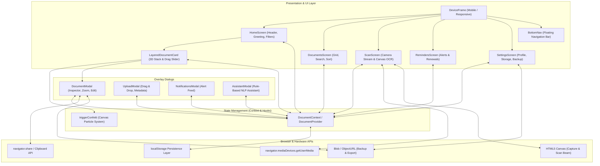

# PaperTrail

> **Never lose an important document again.**

PaperTrail is a modern, personal digital document management application designed to organize, track, and protect critical personal documents in one unified vault. It solves the everyday problem of fragmented records—identity cards, vehicle policies, warranties, academic certificates, leases, and medical records—scattered across email threads, download folders, messaging apps, and physical filing cabinets.

Built with **React 19**, **TypeScript**, **Tailwind CSS**, and **Framer Motion**, PaperTrail combines a tactile, mobile-first design language with responsive workspace adaptability, real-time expiration tracking, camera document scanning, and zero-configuration local persistence.

---

## Table of Contents

- [Motivation](#motivation)
- [Problem Statement](#problem-statement)
- [The Solution](#the-solution)
- [Core Workflows](#core-workflows)
- [Feature Matrix](#feature-matrix)
- [How PaperTrail Works](#how-papertrail-works)
- [Technology Stack](#technology-stack)
- [Architecture](#architecture)
- [Repository Structure](#repository-structure)
- [Getting Started](#getting-started)
  - [Prerequisites](#prerequisites)
  - [Installation](#installation)
  - [Running the Development Server](#running-the-development-server)
  - [Building for Production](#building-for-production)
- [Environment Configuration](#environment-configuration)
- [Security and Privacy](#security-and-privacy)
- [Interface Highlights & Views](#interface-highlights--views)
- [Product Roadmap](#product-roadmap)
- [Contributing](#contributing)
- [License](#license)

---

## Motivation

Throughout our adult lives, we accumulate dozens of essential documents:
- **Identity records**: Passports, national IDs, driver's licenses, birth certificates.
- **Academic & career records**: University degrees, transcripts, professional certifications, employment contracts.
- **Financial & property documents**: Residential leases, property tax receipts, mortgage agreements, loan terms.
- **Insurance policies**: Automobile liability, health coverage, homeowner policies, life insurance.
- **Consumer warranties**: Electronics purchase receipts, hardware coverage plans, warranty cards.
- **Medical records**: Immunization history, dental coverage plans, prescriptions.

In practice, these files live in haphazard places: buried in an email attachment from two years ago, resting in a smartphone camera roll, sitting in a desktop `Downloads` directory with an unhelpful filename like `scan_003892.pdf`, or tucked into a physical drawer.

When a sudden need arises—renewing an automobile registration, proving health coverage during an emergency, applying for a visa, or claiming a warranty repair—retrieving the correct, up-to-date document under time pressure is unnecessarily frustrating. Furthermore, critical expiration deadlines are frequently overlooked until penalties apply or coverage lapses.

PaperTrail is motivated by a straightforward operating principle:

> **Important documents should be easy to find, effortless to verify, and difficult to lose track of.**

---

## Problem Statement

PaperTrail addresses the following specific friction points in personal document stewardship:

1. **Fragmented Storage**: Documents are spread across multiple cloud drives, local folders, chat apps, and physical paper piles with no central index.
2. **Absence of Expiration Awareness**: Standard file managers (Finder, Windows Explorer, Google Drive) treat documents as static byte blobs. They possess no awareness of policy expiry dates, warranty deadlines, or renewal windows.
3. **Retrieval Friction Under Pressure**: Users cannot quickly locate policy numbers, validity periods, or issuing bodies without downloading, opening, and scanning through multi-page PDFs.
4. **Poor Mobile Scanning Experience**: Snapping a camera photo often produces distorted perspectives, poor contrast, and unindexed files that get lost among personal photos.
5. **Cumbersome Sharing**: Sending a document often involves searching for the file, verifying it is the correct version, opening an external email client, and manually attaching it.

---

## The Solution

PaperTrail transforms passive document storage into an **active personal document vault**:

- **Centralized Vault**: Consolidates documents across standardized categories (*Insurance, Identity, Vehicle, Education, Warranty, Finance, Medical*) with consistent metadata schemas.
- **Proactive Expiration Tracking**: Automatically calculates remaining validity, highlights urgent renewal windows (*Critical < 15 days*, *Warning < 45 days*), and maintains dedicated expiration alerts.
- **Interactive Stacking Hero Interface**: The home screen highlights top-priority expiring items in a distinctive 3D layered cobalt card stack, letting users swipe, inspect, and slide-to-verify records in seconds.
- **Integrated Camera Scanner**: Uses the browser's hardware media APIs to stream, frame, align, crop, and capture physical documents directly into the vault.
- **Local-First Privacy**: Operates entirely within the user's browser runtime. Vault records persist across sessions via client-side storage with zero third-party tracking or mandatory server uploads.

---

## Core Workflows

```
┌─────────────────┐       ┌────────────────────┐       ┌──────────────────┐
│  Upload / Scan  │ ───>  │ Metadata Indexing  │ ───>  │ Expiration Watch │
│ File / Camera   │       │ Category & Policy #│       │ Countdown Engine │
└─────────────────┘       └────────────────────┘       └──────────────────┘
                                                                 │
                                                                 ▼
┌─────────────────┐       ┌────────────────────┐       ┌──────────────────┐
│ Backup / Share  │ <───  │ Document Details   │ <───  │ Priority Stacks  │
│ Export / Native │       │ Zoom, Edit, Verify │       │ Filtered Vault   │
└─────────────────┘       └────────────────────┘       └──────────────────┘
```

1. **Ingestion**: The user either drops an existing file (PDF, PNG, JPG) into the **Upload Modal** or launches the **Camera Scanner** to capture a physical document with real-time framing guides.
2. **Cataloging & Metadata**: The record is tagged with an issuing authority, policy or document identification number, issue date, optional expiration date, and descriptive tags.
3. **Expiration Engine**: If an expiration date is provided, PaperTrail computes a live day countdown and classifies the urgency (`critical`, `warning`, or `normal`).
4. **Vault Organization**: Records appear under categorized tabs and filter chips (*All*, *Recent*, *Expiring soon*) with instant multi-field text search.
5. **Review & Verification**: Tapping any document opens the zoomable inspector to review metadata, edit notes, trigger client downloads, or dispatch the document via the native Web Share API.
6. **Backup & Portability**: Users can export their complete vault structure as a portable, standardized JSON backup at any time.

---

## Feature Matrix

The following table provides an honest accounting of PaperTrail's current capabilities, distinguishing between fully working implementations, simulated/partial functionality, and planned roadmap items.

| Domain | Capability | Status | Implementation Details |
| :--- | :--- | :--- | :--- |
| **Document Ingestion** | File Upload (PDF, PNG, JPG, JPEG) | **Implemented** | Drag-and-drop & native file picker with size calculation and type validation in [`UploadModal.tsx`](file:///c:/Users/lohit/Downloads/PaperTraiL/src/components/UploadModal.tsx). |
| | Camera Scanner (`getUserMedia`) | **Implemented** | Live webcam/environment video stream with shutter capture to HTML5 canvas in [`ScanScreen.tsx`](file:///c:/Users/lohit/Downloads/PaperTraiL/src/screens/ScanScreen.tsx). |
| | Scanner Image Transformation | **Implemented** | 90° clockwise rotation steps, framing guides, and simulated auto-crop overlays. |
| | OCR & Text Extraction | **Partially Implemented** | Simulated OCR parsing engine that pre-populates extracted fields with interactive manual override. Production Tesseract.js / Cloud Vision is planned. |
| **Organization & Search** | Categorization | **Implemented** | 7 preconfigured categories: *Insurance, Identity, Vehicle, Education, Warranty, Finance, Medical*. |
| | Multi-Field Real-Time Search | **Implemented** | Live instant substring search across document titles, categories, issuers, policy IDs, and `#tags`. |
| | Live Filter Chips | **Implemented** | *All*, *Recent*, and *Expiring soon* chips with reactive document counters and animated pill transitions. |
| | Sorting | **Implemented** | Three sort orders: *Newest First*, *Days Remaining (Expiry)*, and *Alphabetical (A–Z)*. |
| | Signature 3D Card Stack | **Implemented** | Layered cobalt blue hero card with offset background cards, tap-to-bring-forward, and interactive drag-to-verify slider. |
| **Reminders & Expirations**| Expiry Countdown | **Implemented** | Computed dynamic day-difference engine based on current system time. |
| | Urgency Status Badges | **Implemented** | Color-coded badges: *Critical (<15 days)*, *Warning (<45 days)*, and *Normal*. |
| | Custom Reminder Creation | **Implemented** | Create custom reminders tied to existing vault documents with arbitrary due dates. |
| | Resolution & Renewal Toggle | **Implemented** | One-tap completion toggle with particle confetti celebration. |
| | Push / Email Notifications | **Planned** | Requires server daemon or Web Push service worker integration. |
| **Document Interaction** | Document Detail Inspector | **Implemented** | Modal viewer with simulated official seal, AES-256 encryption watermark, and metadata grid. |
| | Document Zoom Controls | **Implemented** | Interactive scale toggling (1.0x to 1.25x) inside the preview canvas. |
| | Metadata Editing | **Implemented** | In-place editing of title, expiration date, and notes with reactive state updates. |
| | Document Deletion | **Implemented** | Safe deletion with confirmation prompt, cascading reminder cleanup, and notification dispatch. |
| | Native Document Sharing | **Implemented** | Uses browser Web Share API (`navigator.share`) with automatic clipboard text fallback. |
| | File Record Export | **Implemented** | Client-side blob generation allowing users to download formatted `.txt` document records. |
| | Multi-Page PDF Rendering | **Planned** | PDF canvas rendering via PDF.js is scheduled for the next release. |
| **Account & Security** | Client Profile Management | **Implemented** | Name and tagline editing with live header updates. |
| | Storage Usage Breakdown | **Implemented** | Visual capacity meter indicating document count against local quota. |
| | Local-First Storage | **Implemented** | Browser `localStorage` persistence (`papertrail_*_v1` keys) with automatic synchronization. |
| | Full Vault JSON Backup | **Implemented** | One-click export of complete vault state (profile, documents, reminders) to a timestamped JSON file. |
| | Client-Side Encryption UI | **Partially Implemented** | AES-256 status toggle and biometric unlock configuration. Native WebCrypto API integration is planned. |
| | Multi-User Cloud Auth | **Planned** | Centralized database authentication (JWT/OAuth) planned for cloud milestone. |
| **Assistant & Helpers** | PaperTrail AI Assistant | **Implemented** | Contextual modal with rule-based vault NLP matcher that resolves expiring items, vehicle policies, and IDs with direct deep-linking. |
| | Notifications Tray | **Implemented** | Dropdown drawer tracking vault events, document verifications, and unread badges. |
| | Viewport Adaptability | **Implemented** | Seamless switching between an iPhone mobile frame and an expanded widescreen layout. |

---

## How PaperTrail Works

### 1. Ingestion Pipeline
When a user uploads or captures a file:
- **File Upload**: The file's MIME type, size, and name are read via the HTML5 File API. For images, a data URL is generated for immediate thumbnail rendering.
- **Camera Scan**: The scanner requests video stream access via `navigator.mediaDevices.getUserMedia`. Upon triggering the shutter, video frames are drawn onto an in-memory `<canvas>` element and exported as a high-resolution JPEG data URL.

### 2. State & Persistence Engine
PaperTrail utilizes React Context (`DocumentProvider`) as a single source of truth:
- Every mutation (adding documents, modifying notes, verifying status, completing reminders) updates the in-memory state and immediately writes to `localStorage` under isolated keys:
  - `papertrail_documents_v1`: Master list of documents and metadata.
  - `papertrail_reminders_v1`: Scheduled renewal and expiration reminders.
  - `papertrail_notifications_v1`: System and policy alert log.
  - `papertrail_profile_v1`: User profile preferences.
  - `papertrail_device_mode_v1`: Viewport mode preference (`mobile` vs. `responsive`).

### 3. Expiration Tracking Math
The expiration engine runs whenever documents are loaded or updated:
$$\text{daysLeft} = \left\lceil \frac{T_{\text{expiry}} - T_{\text{current}}}{1000 \times 60 \times 60 \times 24} \right\rceil$$
- If $\text{daysLeft} \le 15$, the document receives a `critical` urgency rating and triggers warning badges on the home dashboard.
- If $15 < \text{daysLeft} \le 45$, it receives a `warning` status.

### 4. Search & Filter Indexing
Search queries are evaluated against multiple fields simultaneously:
$$\text{match} = \text{title} \cup \text{category} \cup \text{issuer} \cup \text{tags} \cup \text{policyNumber}$$
Filtering by chip (*All*, *Recent*, *Expiring soon*) operates as an intersection over the search result set, ensuring predictable document retrieval.

---

## Technology Stack

The technology stack is derived strictly from the project's dependency manifest and source code:

| Layer | Technology | Version | Purpose in PaperTrail |
| :--- | :--- | :--- | :--- |
| **Runtime & Core** | [React](https://react.dev/) | `^19.0.0` | Declarative UI component architecture. |
| | [React DOM](https://react.dev/) | `^19.0.0` | Virtual DOM rendering and event normalization. |
| | [TypeScript](https://www.typescriptlang.org/) | `~5.7.2` | Static type safety across document schemas, context actions, and event handlers. |
| **Build & Tooling** | [Vite](https://vite.dev/) | `^6.1.0` | Fast development server with Hot Module Replacement (HMR) and Rollup production bundling. |
| | [@vitejs/plugin-react](https://github.com/vitejs/vite-plugin-react) | `^4.3.4` | Fast Refresh Babel/JSX transformation. |
| **Styling & Design** | [Tailwind CSS](https://tailwindcss.com/) | `^3.4.17` | Utility-first styling engine with custom color ramps (`primary: #0861E8`, `canvas: #EBECEF`, `surface: #F7F7F7`). |
| | [PostCSS](https://postcss.org/) | `^8.5.2` | CSS processing pipeline. |
| | [Autoprefixer](https://github.com/postcss/autoprefixer) | `^10.4.20` | Vendor prefix automation for cross-browser CSS support. |
| | [clsx](https://github.com/lukeed/clsx) & [tailwind-merge](https://github.com/dcastil/tailwind-merge) | `^2.1.1` / `^3.0.1` | Conflict-free conditional CSS class composition. |
| **Animation & Motion**| [Framer Motion](https://www.framer.com/motion/) | `^12.4.7` | Hardware-accelerated gesture dragging (drag-to-verify slider), layout transitions (`layoutId`), and modal springs. |
| **Iconography** | [Lucide React](https://lucide.dev/) | `^1.16.0` | Consistent, clean icon set matching reference mobile guidelines. |
| **Storage & Platform**| Web Storage API | Native | Client-side persistent JSON storage via `localStorage`. |
| | Web MediaDevices API | Native | Hardware camera streaming for mobile and desktop document scanning. |
| | Web Share & Clipboard API | Native | Native OS sharing sheet integration with fallback clipboard export. |

---

## Architecture

The diagram below reflects the **actual running client-side architecture** implemented in the repository:



---

## Repository Structure

```
PaperTraiL/
├── .env.example              # Template for environment configuration
├── index.html                # Application root HTML with font preconnects
├── package.json              # Dependency declarations and build scripts
├── package-lock.json         # Pinned dependency tree
├── postcss.config.js         # PostCSS configuration for Tailwind CSS
├── tailwind.config.js        # Custom theme, radii, colors, and shadows
├── tsconfig.json             # TypeScript compiler settings for Vite bundler
├── vite.config.ts            # Vite build setup with React plugin
└── src/
    ├── App.tsx               # Root view router & modal container
    ├── index.css             # Tailwind base styles and utility definitions
    ├── main.tsx              # React 19 application entry point
    ├── components/
    │   ├── AssistantModal.tsx      # In-vault conversational AI assistant
    │   ├── BottomNav.tsx           # Floating rounded pill navigation bar
    │   ├── Confetti.ts             # Lightweight zero-dependency particle engine
    │   ├── DeviceFrame.tsx         # Mobile mockup and expanded workspace wrapper
    │   ├── DocumentModal.tsx       # Detail view, zoom viewer, edit, and export
    │   ├── FilterChips.tsx         # Horizontal category filter pills with live counts
    │   ├── Greeting.tsx            # High-contrast bold greeting banner
    │   ├── Header.tsx              # Profile avatar, verified badge, and quick actions
    │   ├── LayeredDocumentCard.tsx # Signature 3D cobalt hero card with drag slider
    │   ├── NotificationsModal.tsx  # Activity log and expiration alert drawer
    │   └── UploadModal.tsx         # File drop zone and document metadata form
    ├── context/
    │   └── DocumentContext.tsx     # Global state machine and localStorage sync
    ├── data/
    │   └── mockData.ts             # Initial seeded sample documents and profile
    ├── screens/
    │   ├── DocumentsScreen.tsx     # Full document directory with search and sorting
    │   ├── HomeScreen.tsx          # Mobile dashboard replicating reference layout
    │   ├── RemindersScreen.tsx     # Expiration timeline and renewal checklist
    │   ├── ScanScreen.tsx          # Camera viewfinder and OCR capture interface
    │   └── SettingsScreen.tsx      # Vault storage, privacy toggles, and JSON export
    └── types/
        └── index.ts                # TypeScript interfaces for documents, reminders, etc.
```

---

## Getting Started

### Prerequisites

Ensure you have the following installed on your machine:
- **Node.js**: `v18.0.0` or higher (verified compatible with Node `v20.x` and `v24.x`).
- **npm**: `v9.0.0` or higher (bundled with Node).

To verify your local installation:
```bash
node -v
npm -v
```

### Installation

1. **Clone the repository**:
   ```bash
   git clone https://github.com/your-username/papertrail.git
   cd papertrail
   ```

2. **Install project dependencies**:
   ```bash
   npm install
   ```

### Running the Development Server

Start the local Vite development server:
```bash
npm run dev
```

By default, the application will be accessible at:
```
http://localhost:5173/
```

To expose the development server to your local network (e.g. testing the camera scanner on a physical mobile phone):
```bash
npm run dev -- --host
```

### Building for Production

Compile TypeScript and build the optimized production assets:
```bash
npm run build
```

The output will be generated in the `dist/` directory. You can preview the production build locally:
```bash
npm run preview
```

---

## Environment Configuration

PaperTrail is designed as a **zero-configuration, local-first application**. It runs immediately upon `npm install` without requiring external database setups, third-party API keys, or cloud infrastructure.

An optional template file is provided at [`.env.example`](file:///c:/Users/lohit/Downloads/PaperTraiL/.env.example):

```bash
# Copy template to .env.local if you wish to customize local settings
cp .env.example .env.local
```

### Variable Reference

| Variable Name | Required | Default Value | Description |
| :--- | :--- | :--- | :--- |
| `VITE_PORT` | Optional | `5173` | The local port on which the Vite development server binds. |
| `VITE_APP_TITLE` | Optional | `"PaperTrail — Personal Document Vault"` | Document title displayed in the browser tab. |
| `VITE_API_BASE_URL` | Optional | *(None)* | Reserved for future integration with a remote backend service. |

> **Note**: Never commit your `.env.local` file with sensitive credentials to public version control.

---

## Security and Privacy

Because PaperTrail is designed for personal records, security and privacy are treated with strict honesty:

### Implemented Controls
- **Client-Side Execution**: All document data, metadata, reminders, and user profiles are stored locally in the browser's `localStorage`. No document data is transmitted over the internet to external analytics or advertising servers.
- **Hardware Permission Isolation**: Camera streaming uses standard browser permission prompts (`getUserMedia`) and immediately halts stream tracks when navigating away from the scanner screen or closing the tab.
- **Portable Backups**: Users have direct ownership of their data through JSON backup export, allowing complete portability and client-side deletion.
- **No Third-Party Trackers**: The codebase contains zero external tracking scripts, telemetry agents, or behavioral fingerprinting.

### Realistic Limitations & Production Recommendations
- **Unencrypted LocalStorage**: Data stored in browser `localStorage` is accessible to scripts within the same origin and is unencrypted at the disk level unless the host operating system enforces full-disk encryption (e.g. BitLocker or FileVault).
- **Client-Side Vault Seals**: The current AES-256 seal status in the settings screen is a prototype configuration toggle. Production hardening should integrate the **WebCrypto API** (`crypto.subtle`) with user-supplied passphrases using PBKDF2/Argon2 key derivation for on-disk file encryption.
- **No Cloud Synchronization**: In the current version, clearing browser cookies/site data will reset the vault to initial defaults unless a backup JSON file has been exported.

---

## Interface Highlights & Views

PaperTrail's interface closely follows the design language of modern tactile mobile applications while remaining fully functional on desktop workspaces.

### Viewport Modes
The top utility bar on desktop screens allows toggling between two display modes:
1. **Reference Mobile View**: Centers a realistic 430px iPhone-style frame with iOS status bar (`9:41`), dynamic island styling, rounded 48px bezel, and home indicator.
2. **Expanded View**: Expands the interface to a wider tablet and desktop layout (`max-w-5xl`) while preserving identical typographic and card proportions.

### Screen Breakdown

```
┌────────────────────────────────────────────────────────┐
│ [Avatar] Lohith Kumar  [Verified]        [Chat] [Bell] │ Header & Actions
│                                                        │
│ HI LOHITH, nice to see you!                            │ Greeting Typography
│ Your documents are safe with us!                       │
│                                                        │
│ [ All 6 ]  [ Recent 3 ]  [ Expiring soon 2 ]           │ Filter Chips
│                                                        │
│ ┌────────────────────────────────────────────────────┐ │
│ │ (Category Badges)               (12 Days Left Pill)│ │ Layered Hero Card
│ │ [⚑ EXPIRING SOON]                                  │ │ Saturated Cobalt Blue
│ │ Vehicle Insurance Policy                           │ │ 3D Stack Depth
│ │ GEICO Auto • POL-88392-GEICO                       │ │
│ │ [ (✓) Drag to mark done >>> ]               [Edit] │ │ Slider & Action
│ └────────────────────────────────────────────────────┘ │
│                                                        │
│ Vault Documents (6)                          See all > │ Recent Vault Grid
│ [Insurance]  Vehicle Insurance Policy        12d left  │
│ [Identity]   International Passport          Verified  │
│                                                        │
│       ( [Home]   [Docs]   [Scan]   [Alerts]   [Gear] ) │ Floating Bottom Nav
└────────────────────────────────────────────────────────┘
```

- **Dashboard ([`HomeScreen.tsx`](file:///c:/Users/lohit/Downloads/PaperTraiL/src/screens/HomeScreen.tsx))**: Houses the signature cobalt blue 3D stacked card, drag-to-verify slider, greeting banner, and dynamic filter chips.
- **Documents Directory ([`DocumentsScreen.tsx`](file:///c:/Users/lohit/Downloads/PaperTraiL/src/screens/DocumentsScreen.tsx))**: Full list view with real-time text search, category chips, sort dropdown, and tag explorer.
- **Scanner Viewfinder ([`ScanScreen.tsx`](file:///c:/Users/lohit/Downloads/PaperTraiL/src/screens/ScanScreen.tsx))**: Camera viewport with animated laser scanning beam, rotation tools, and OCR extraction forms.
- **Expiration Alerts ([`RemindersScreen.tsx`](file:///c:/Users/lohit/Downloads/PaperTraiL/src/screens/RemindersScreen.tsx))**: Organized by urgency status with countdown meters and custom alert creation.
- **Vault Settings ([`SettingsScreen.tsx`](file:///c:/Users/lohit/Downloads/PaperTraiL/src/screens/SettingsScreen.tsx))**: Storage breakdown meter, profile editor, security switches, and JSON data backup/reset tools.

---

## Product Roadmap

The development of PaperTrail is structured into four sequential phases:

### Phase 1: Client Foundation *(Current)*
- [x] Complete mobile-first design recreation with high visual fidelity.
- [x] 3D layered document card stack with interactive gesture-driven slider.
- [x] Client-side state machine with `localStorage` persistence.
- [x] Real-time search, categorization, and sorting.
- [x] Hardware camera scanning via Web MediaDevices API.
- [x] Expiration alert countdown engine and reminder creation.
- [x] JSON vault backup export and restore capability.

### Phase 2: Native Document Intelligence *(Next)*
- [ ] Integration of client-side [Tesseract.js](https://github.com/naptha/tesseract.js) for true offline OCR text extraction.
- [ ] Multi-page PDF rendering and thumbnail generation via [PDF.js](https://mozilla.github.io/pdf.js/).
- [ ] Automated boundary and corner detection using computer vision edge filters.
- [ ] Smart document type classification based on extracted keywords.

### Phase 3: Dedicated Backend & Storage
- [ ] Optional REST / GraphQL backend (Node.js or Go).
- [ ] Relational database persistence (PostgreSQL / SQLite).
- [ ] S3-compatible encrypted object storage (AWS S3, Cloudflare R2, or MinIO) with pre-signed upload URLs.
- [ ] End-to-end client-side encryption using the WebCrypto API (`AES-GCM-256`).

### Phase 4: Sync & Multi-Platform
- [ ] Progressive Web App (PWA) manifest with service worker offline caching.
- [ ] Automated push and email notifications for policy renewals.
- [ ] Time-limited, password-protected public share links with revocation controls.
- [ ] Family vault mode with role-based access permissions.

---

## Contributing

Contributions from developers, designers, and documentation writers are welcome.

### Development Process

1. **Fork the repository** on GitHub.
2. **Create a topic branch** from `main`:
   ```bash
   git checkout -b feature/document-tag-filtering
   ```
3. **Commit your changes** following conventional commit standards:
   ```bash
   git commit -m "feat(vault): add multi-tag intersection filter to document grid"
   ```
4. **Verify types and build integrity**:
   ```bash
   npm run build
   ```
5. **Push to your fork**:
   ```bash
   git push origin feature/document-tag-filtering
   ```
6. **Open a Pull Request** describing your changes, technical decisions, and testing steps.

### Reporting Issues & Requesting Features
- Please use GitHub Issues to report bugs or request new features.
- When filing a bug report, include your operating system, browser version, and clear steps to reproduce the issue.

---

## License

This project is currently distributed as an open-source technical reference and personal document management application. 

*(If you plan to release PaperTrail under a formal open-source license such as MIT or Apache 2.0, add a `LICENSE` file in the root directory).*

---

*PaperTrail — Engineered with care for clean, reliable personal document management.*
