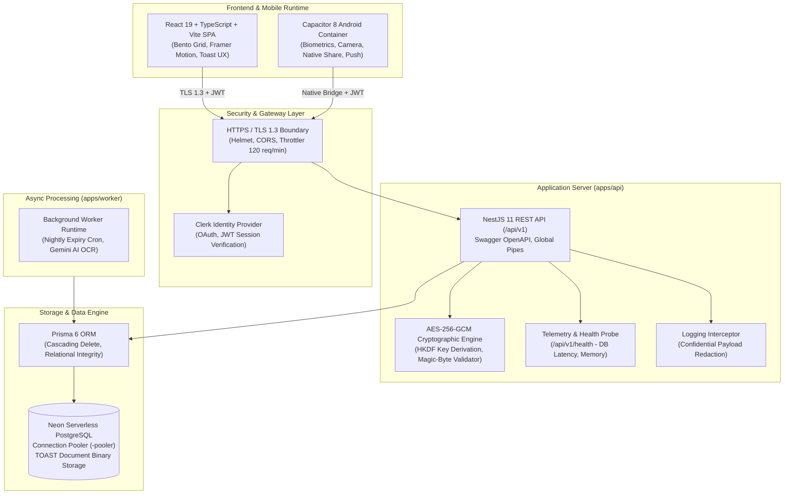

<div align="center">

# 🛡️ PaperTrail

### Enterprise-Grade Sovereign Digital Document Vault & Compliance Ecosystem

[](https://turbo.build/)
[](#cryptographic--security-guarantees)
[](https://neon.tech/)
[](https://clerk.com/)
[](https://capacitorjs.com/)
[](#legal-compliance--data-protection-dpdp-act-2023)
[-success?style=for-the-badge)](#testing--quality-assurance)

<p align="center">
  <strong>Every critical credential, policy, and document. One immutable, encrypted, sovereign vault.</strong>
</p>

<p align="center">
  <a href="#executive-summary">Executive Summary</a> •
  <a href="#system-architecture">System Architecture</a> •
  <a href="#cryptographic--security-guarantees">Security Guarantees</a> •
  <a href="#monorepo-topology">Monorepo Topology</a> •
  <a href="#quick-start--local-development">Quick Start</a> •
  <a href="#api-reference-overview">API Reference</a> •
  <a href="#production-deployment">Production Deployment</a> •
  <a href="#legal-compliance--data-protection-dpdp-act-2023">DPDP Act Compliance</a>
</p>

---

</div>

## Executive Summary

**PaperTrail** is a multi-tenant, zero-knowledge personal digital vault platform engineered for high-assurance document governance. It bridges modern web engineering with native mobile device capabilities, providing an intuitive consumer interface underpinned by defense-grade security protocols.

Whether safeguarding international passports, vehicle cover notes, academic degrees, or recurring insurance policies, PaperTrail automates the entire document lifecycle:
* **Cryptographic Ingestion:** Client-side binary validation, magic-byte inspection, SHA-256 duplicate detection, and military-grade **AES-256-GCM** authenticated envelope encryption.
* **Direct Database Storage:** Leverages **Neon Serverless PostgreSQL** out-of-line TOAST storage partitions with tenant-isolated row-level access controls.
* **Intelligent Lifecycle Automation:** Real-time OCR metadata parsing, automated expiration tracking, and multi-tier proactive renewal notifications (30, 15, and 3-day thresholds).
* **Controlled Sharing:** Cryptographic time-delimited public access tokens with granular permissions (*View Only* vs *View & Download*) and immediate revocation capability.
* **Regulatory Compliance:** Built from the ground up to satisfy the statutory mandates of India's **Digital Personal Data Protection Act, 2023 (DPDP)** and the **EU General Data Protection Regulation (GDPR)**.

---

## System Architecture

PaperTrail is organized as an enterprise monorepo driven by **Turborepo** and **pnpm workspaces**, separating concerns into independently deployable application runtimes and strictly versioned shared core packages:



---

## Cryptographic & Security Guarantees

Security in PaperTrail is structural, not an afterthought. The platform enforces defense-in-depth across the entire request-response and data persistence pipeline:

### 1. Authenticated Envelope Encryption (AES-256-GCM)
* **Encryption Standard:** Reviewed **AES-256-GCM** (Galois/Counter Mode) authenticated encryption executed natively via Node.js `node:crypto`.
* **Key Derivation (RFC 5869):** 256-bit tenant-isolated keys derived using **HKDF (HMAC-based Extract-and-Expand Key Derivation Function)** combining the server master secret with the unique user identifier (`userId`) as cryptographic salt.
* **Integrity Tagging:** Each document is encrypted with a distinct 12-byte random Initialization Vector (IV). A 16-byte GCM authentication tag is computed and verified on decryption. Any byte manipulation triggers an immediate integrity failure rejection before ciphertext execution.
* **Payload Serialization Format:** `pt_v1:<iv_hex>:<auth_tag_hex>:<ciphertext_base64>`

### 2. File Signature (Magic Bytes) Ingestion Defense
PaperTrail rejects malicious executables masquerading as harmless documents. Ingestion inspects real binary magic headers regardless of the declared file extension:
* **PDF:** `%PDF` (`0x25 0x50 0x44 0x46`)
* **PNG:** `\x89PNG\r\n\x1a\n` (`0x89 0x50 0x4E 0x47`)
* **JPEG:** `\xFF\xD8\xFF`
* **WEBP:** `RIFF....WEBP` (`0x52 0x49 0x46 0x46` ... `0x57 0x45 0x42 0x50`)

### 3. Duplicate Detection via SHA-256 Checksums
A deterministic SHA-256 cryptographic digest is computed on every uploaded file payload. This prevents redundant storage allocation and allows users to trace duplicate entries across categories.

### 4. Confidential Log Sanitization
The API utilizes a global `LoggingInterceptor` that intercepts all inbound HTTP payloads, stripping sensitive fields (`fileData`, `password`, `token`, `secret`, `policyNumber`, `ocrText`) to ensure zero plaintext credential exposure in server logs or monitoring aggregators.

---

## Monorepo Topology

```
papertrail/
├── apps/
│   ├── api/                          # Enterprise NestJS 11 REST API (/api/v1)
│   │   ├── src/
│   │   │   ├── auth/                 # Clerk JWT guard, user profile sync, onboarding state
│   │   │   ├── crypto/               # AES-256-GCM engine, HKDF derivation, magic-byte validator
│   │   │   ├── documents/            # Vault CRUD, search, Neon DB storage integration
│   │   │   ├── folders/              # Hierarchical folder organisation
│   │   │   ├── health/               # /api/v1/health probe (Neon DB latency, memory, uptime)
│   │   │   ├── notifications/        # In-app notification dispatcher & read tracking
│   │   │   ├── ocr/                  # Gemini OCR metadata extraction service
│   │   │   ├── prisma/               # Global PrismaService connecting to Neon DB pooler
│   │   │   ├── reminders/            # Expiration mathematics & urgency classification
│   │   │   ├── sharing/              # Time-limited cryptographic sharing links
│   │   │   ├── common/               # LoggingInterceptor with sensitive field redaction
│   │   │   └── main.ts               # Server bootstrap, Helmet, CORS, Swagger setup
│   │
│   ├── web/                          # React 19 + TypeScript + Vite + Capacitor 8
│   │   ├── android/                  # Native Android Studio container & Gradle config
│   │   ├── src/
│   │   │   ├── auth/                 # Clerk authentication provider & branded AuthLayout
│   │   │   ├── components/           # BentoDock, DocumentModal, UploadModal, LegalModal
│   │   │   ├── context/              # DocumentContext, storage quota derivation, offline cache
│   │   │   ├── screens/              # BentoHomeScreen, DocumentDetail, Onboarding, Settings
│   │   │   └── services/             # Type-safe API client & native device bridges
│   │
│   └── worker/                       # Asynchronous background worker runtime (Inngest / cron)
│
├── packages/
│   ├── api-client/                   # Isomorphic, type-safe API client consumed by clients
│   ├── contracts/                    # REST DTO interfaces and canonical route constants
│   ├── types/                        # Core domain models (DocumentItem, User, ReminderItem)
│   ├── validators/                   # Runtime Zod validation schemas for all inbound payloads
│   ├── design-tokens/                # Visual hierarchy, cobalt blue palette, spacing tokens
│   └── config/                       # Standardized TypeScript and ESLint configurations
│
├── prisma/
│   └── schema.prisma                 # Neon PostgreSQL schema with TOAST storage & cascading rules
│
├── docs/                             # Exhaustive technical documentation & architecture manuals
│   ├── architecture.md               # Complete system design & data flows
│   ├── api-reference.md              # Line-by-line REST API endpoint reference & schemas
│   ├── database-schema.md            # Prisma models, TOAST storage, indexes & connection pooling
│   ├── security.md                   # Cryptographic engine specifications & threat model
│   ├── deployment.md                 # Production deployment runbook (Vercel, Railway, Neon)
│   └── compliance-dpdp.md            # India DPDP Act 2023 & GDPR legal compliance guide
│
├── tests/
│   ├── onboarding.test.mjs           # Multi-step onboarding journey & schema validation tests
│   └── production-essentials.test.mjs# AES-256-GCM, magic-bytes, checksums & health probe tests
│
├── pnpm-workspace.yaml               # Monorepo workspace orchestration
├── turbo.json                        # Turborepo task pipeline & dependency cache
└── package.json                      # Monorepo root scripts & tooling
```

---

## Quick Start & Local Development

### System Prerequisites
* **Node.js**: `v20.x` or `v22.x` (LTS recommended)
* **Package Manager**: `pnpm` `v12.x` (`npm install -g pnpm`)
* **Android Development (Optional)**: Android Studio Ladybug+ with Android SDK Platform 35 and Java 21 JDK.

### 1. Repository Setup
```bash
git clone https://github.com/your-org/papertrail.git
cd papertrail
pnpm install
```

### 2. Environment Configuration
Populate your environment configurations. Copy the template:
```bash
cp .env.example .env
cp apps/api/.env.example apps/api/.env
cp apps/web/.env.example apps/web/.env
```

Ensure your `apps/api/.env` points to your Neon PostgreSQL instance:
```env
PORT=8000
NODE_ENV=development
DATABASE_URL="postgresql://<user>:<password>@<neon-pooler-endpoint>/neondb?sslmode=require"
VAULT_MASTER_KEY="your-high-entropy-master-secret-key-32-bytes"
CLERK_SECRET_KEY="sk_test_..."
FRONTEND_URL="http://localhost:5173"
```

### 3. Generate Prisma Client
```bash
pnpm --filter @papertrail/api prisma:generate
```

### 4. Run Development Services
Launch the complete full-stack environment concurrently via Turborepo:
```bash
# Concurrently start Web client and Backend API
pnpm dev

# Or launch services individually:
pnpm dev:web    # React Web App on http://localhost:5173
pnpm dev:api    # NestJS API on http://localhost:8000/api/v1
```

Access the interactive OpenAPI / Swagger UI at:  
👉 **`http://localhost:8000/api/docs`**

---

## Testing & Quality Assurance

PaperTrail enforces automated testing across cryptographic integrity, schema validation, multi-step state machine persistence, and boundary security:

```bash
# Execute entire test suite
pnpm test

# Run specific domain test suites
pnpm test:onboarding    # Onboarding lifecycle & schema enforcement (18 tests)
pnpm test:production    # AES-256-GCM, Magic Bytes, Health Probe, Checksums (11 tests)
```

### Test Suite Summary:
* ✅ **18/18** User Onboarding & Lifecycle State Machine Tests Passed.
* ✅ **11/11** Production Essentials Cryptography & Security Tests Passed.
* 🛡️ **Total:** **29/29 tests passing (100% success rate)**.

---

## API Reference Overview

The API is fully versioned under `/api/v1` and requires a verified Clerk JWT Bearer Token:

```http
Authorization: Bearer <clerk_session_jwt>
```

| Method | Endpoint | Description | Access |
| :--- | :--- | :--- | :--- |
| `GET` | `/api/v1/health` | System health, Neon DB latency & memory telemetry | Public / Monitoring |
| `GET` | `/api/v1/auth/me` | Fetch authenticated profile, quota & settings | User Authenticated |
| `PATCH`| `/api/v1/auth/onboarding` | Advance multi-step onboarding progression | User Authenticated |
| `DELETE`| `/api/v1/auth/account` | Irreversible account & cascading data erasure | User Authenticated |
| `GET` | `/api/v1/documents` | List documents with search, category & filters | User Authenticated |
| `POST`| `/api/v1/documents` | Ingest new document, validate bytes & encrypt in Neon DB | User Authenticated |
| `GET` | `/api/v1/documents/:id` | Retrieve decrypted document by ID (Owner enforced) | User Authenticated |
| `PATCH`| `/api/v1/documents/:id` | Update metadata, tags, notes or expiry date | User Authenticated |
| `DELETE`| `/api/v1/documents/:id` | Permanently delete document and associated reminders | User Authenticated |
| `POST`| `/api/v1/documents/:id/verify` | Cryptographically verify authenticity of document | User Authenticated |
| `GET` | `/api/v1/reminders` | List expiry reminders sorted by due date | User Authenticated |
| `POST`| `/api/v1/reminders` | Create custom expiry reminder notification | User Authenticated |
| `POST`| `/api/v1/share` | Generate time-limited cryptographic sharing token | User Authenticated |
| `GET` | `/api/v1/share/:token` | Resolve shared document preview (TTL enforced) | Token Authenticated |
| `POST`| `/api/v1/share/:token/revoke` | Instantly revoke access to active share token | Owner Authenticated |

*For complete line-by-line request/response schemas, DTOs, and error taxonomy, see [`docs/api-reference.md`](docs/api-reference.md).*

---

## Production Deployment

| Tier | Recommended Platform | Deployment Model |
| :--- | :--- | :--- |
| **Frontend Web** | [Vercel](https://vercel.com/) / Cloudflare Pages | Automated Git CI/CD, Vite SPA preset |
| **Backend API** | [Railway](https://railway.app/) / Render / AWS ECS | Containerized Node.js runtime, port `8000` |
| **Database** | [Neon](https://neon.tech/) | Serverless PostgreSQL with connection pooling |
| **Authentication** | [Clerk](https://clerk.com/) | Production instance with custom domain & OAuth |
| **Mobile Client** | Google Play Store | Signed Android App Bundle (`.aab`) via Capacitor |

*For step-by-step production setup, build commands, and environment checklists, see [`docs/deployment.md`](docs/deployment.md).*

---

## Legal Compliance & Data Protection (DPDP Act, 2023)

PaperTrail is engineered to be strictly compliant with Indian and international privacy statutes:
1. **Digital Personal Data Protection Act, 2023 (India):**
   * **Data Principal Rights:** Native in-app capabilities to access, review, correct, and request immediate permanent erasure of all stored personal documents.
   * **Purpose Limitation:** User documents are stored solely to provide vault services, lifecycle reminders, and user-initiated shares. Personal documents are never monetized, sold, or used for public AI model training.
   * **Grievance Redressal:** Designated Grievance Officer reachable at `grievance@papertrail.app` with statutory 72-hour turnaround guarantees.
2. **Permanent Deletion Guarantee:** When a user initiates account deletion, all database records, encrypted file blobs, reminder schedules, and sharing tokens are purged immediately (`onDelete: Cascade`) with zero residual retention.

*For full regulatory disclosures, visit the in-app Legal Center or read [`docs/compliance-dpdp.md`](docs/compliance-dpdp.md).*

---

## License & Enterprise Support

* **License:** Proprietary / Enterprise Licensed.
* **Security Reporting:** For responsible disclosure of security vulnerabilities, please contact `security@papertrail.app`.
* **Support:** For enterprise deployments or assistance, reach out to `support@papertrail.app`.

<div align="center">
  <sub>© 2026 PaperTrail Inc. All rights reserved. Built with precision for digital sovereignty.</sub>
</div>
