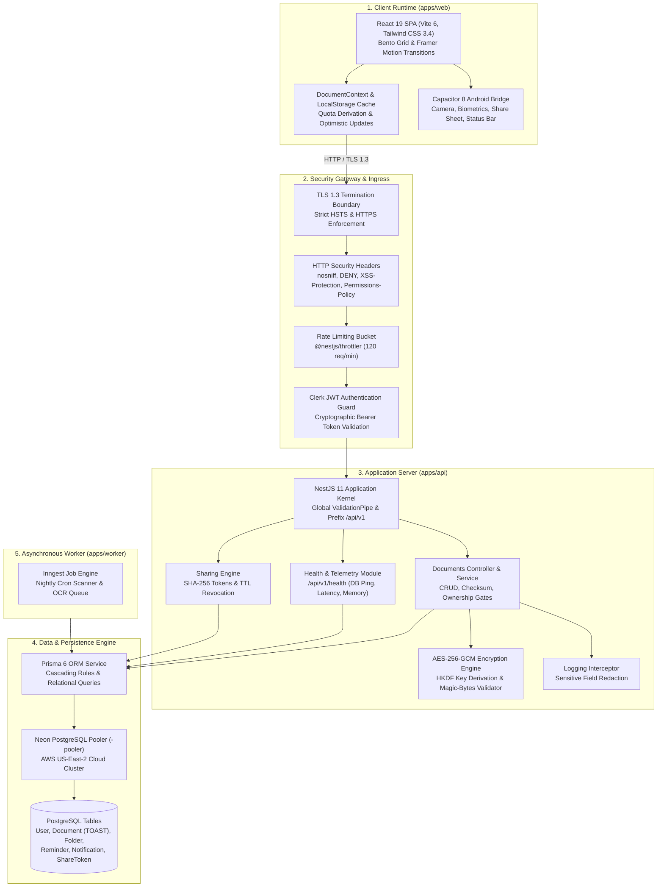
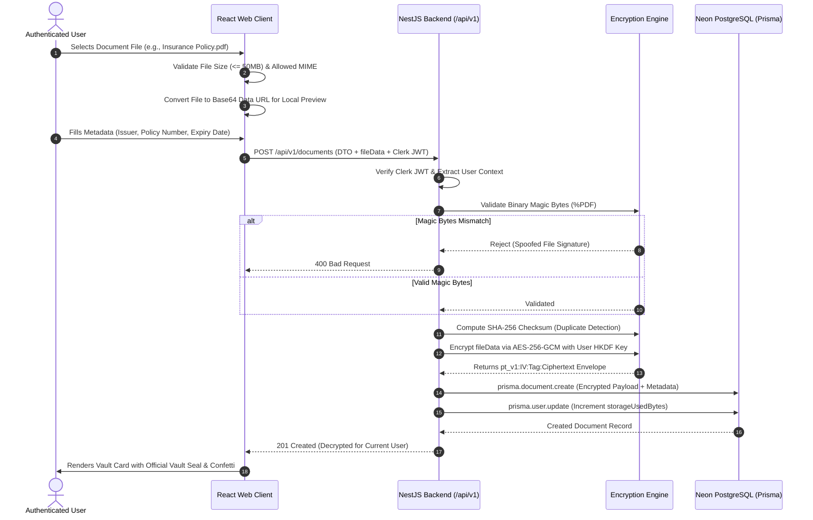

# PaperTrail — Enterprise System Architecture & Subsystem Specification

**Document Version:** 2.0.0 (Production Architecture)  
**Status:** Approved for Production Deployment  
**Author:** PaperTrail Core Architecture & Security Engineering Team  

---

## 1. Architectural Principles & System Design

PaperTrail is designed as a **sovereign digital document custody vault**. The fundamental architectural tenets governing all subsystems are:

1. **Zero-Knowledge Privacy:** Document contents and identifiers are encrypted at the application boundary using authenticated AES-256-GCM. The database engine persists only encrypted ciphertext envelopes.
2. **Server Authoritative Access Control:** Every single read, write, update, share, or delete operation is guarded by verified cryptographic session tokens (Clerk JWT) with strict row-level ownership assertions.
3. **Direct Relational TOAST Ingestion:** Document binaries (PDF, PNG, JPG, WEBP) are stored directly inside **Neon Serverless PostgreSQL** via PostgreSQL's native **TOAST** (The Oversized-Attribute Storage Technique) mechanism, eliminating external object storage complexity while guaranteeing atomic transactions.
4. **Isomorphic Type Safety:** A shared monorepo core ensures that frontend forms, runtime validation schemas, API contracts, and database models are derived from an unalterable single source of truth.
5. **Multi-Platform Fluidity:** The responsive client runtime operates seamlessly across desktop viewports (Bento UI grid), tablets, and native Android hardware containers (Capacitor 8 bridge).

---

## 2. High-Level Subsystem Topology



---

## 3. Subsystem Breakdown & Line-by-Line Specifications

### Subsystem 1: Client Application Runtime (`apps/web`)

* **Framework & Bundler:** React 19.0.0, TypeScript 5.7.2, Vite 6.1.0.
* **Component Paradigm:** Modern Bento layout architecture with adaptive desktop and mobile viewports.
* **State Management:**
  * `DocumentContext.tsx`: Manages active document lists, category filters, global search (`⌘K`), upload modal visibility, and dynamic storage quota calculations derived strictly from real uploaded files.
  * Resilient offline cache via browser `localStorage` ensuring users can inspect their cached document summaries even under network dropouts.
* **Native Android Bridge (`@capacitor/*`):**
  * `Camera`: Hardware camera viewfinder integration for scanning receipts, paper policies, and IDs with automatic flash and crop controls.
  * `Share`: Native Android share-target receiver (`SendIntent`) allowing users to share PDFs or images from other Android apps directly into PaperTrail.
  * `LocalNotifications`: System notification scheduling for impending expiration dates.
  * `StatusBar`: Dynamic style adaptation adjusting to light/dark system themes.

---

### Subsystem 2: Security & Cryptographic Engine (`apps/api/src/crypto`)

The cryptographic subsystem (`EncryptionService`) guarantees defense-grade privacy:

#### 1. Key Derivation (HKDF RFC 5869)
```
Master Secret Key (256-bit) + User ID Salt (Tenant Context)
                 │
                 ▼  HKDF-SHA256 (RFC 5869)
         Tenant Subkey (32 bytes / 256 bits)
```
Each user receives a mathematically isolated encryption key derived from their unique `userId`. Compromising one user's context yields zero mathematical leverage against any other tenant's vault.

#### 2. Authenticated Envelope Encryption (AES-256-GCM)
* **Algorithm:** Standard NIST-reviewed `aes-256-gcm`.
* **IV Generation:** Cryptographically secure 12-byte random initialization vector generated per encryption operation via `crypto.randomBytes(12)`.
* **Authentication Tag:** 16-byte GCM authentication tag verifying ciphertext integrity.
* **Serialization Structure:**
  $$\text{pt\_v1} : \text{IV}_{\text{hex}} : \text{Tag}_{\text{hex}} : \text{Ciphertext}_{\text{base64}}$$

#### 3. Ingestion Magic-Bytes Inspection
To eliminate disguised executable execution (such as renamed Windows PE `.exe` or shell scripts), the binary header is verified before database persistence:
* PDF: Bytes `[0x25, 0x50, 0x44, 0x46]` (`%PDF`)
* PNG: Bytes `[0x89, 0x50, 0x4E, 0x47]` (`\x89PNG`)
* JPEG: Bytes `[0xFF, 0xD8, 0xFF]`
* WEBP: Header `RIFF` and subheader `WEBP`

---

### Subsystem 3: Database & TOAST Storage (`apps/api/src/prisma` & Neon)

PaperTrail utilizes **Neon Serverless PostgreSQL** hosted on AWS US-East-2:
* **Connection Pooling:** Connected through the Neon connection pooler (`ep-muddy-forest-beeyuukm-pooler.c-9.us-east-2.aws.neon.tech`), allowing thousands of concurrent client sessions without exhausting Postgres connection limits.
* **Direct TOAST Storage:** Document payloads are stored in the `Document.fileData` column typed as `@db.Text`. PostgreSQL automatically pushes values exceeding 2 KB into out-of-line **TOAST (The Oversized-Attribute Storage Technique)** tables, applying LZ4/pglz compression. This achieves:
  * Atomic document creation (metadata and file persist in a single transaction).
  * No orphaned files if metadata creation fails.
  * Simplified backups and restores using native PostgreSQL dumps.
* **Cascading Deletion:** Complete relational cascades (`onDelete: Cascade`) guarantee that when a user account is deleted, all documents, folders, reminders, and notifications are erased immediately.

---

### Subsystem 4: Asynchronous Processing & Expiry Engine (`apps/worker`)

* **Daily Expiration Cron:** Scheduled to execute at 08:00 AM UTC daily:
  * Queries documents with `expiryDate` falling within 45, 30, and 15-day intervals.
  * Categorizes urgency into `normal`, `warning`, and `critical`.
  * Generates in-app notifications and queues push/email alerts.
* **AI Metadata Extraction (OCR):** Powered by the Gemini API (`@google/genai`) to parse extracted document text into structured fields (Issuer, Policy Number, Expiry Date).

---

## 4. End-to-End Document Lifecycle Flow



---

## 5. Security & Threat Mitigation Matrix

| Threat Category | Attack Vector | PaperTrail Defensive Control |
| :--- | :--- | :--- |
| **Data Breach at Rest** | Unauthorized database inspection or physical disk theft | **AES-256-GCM Encryption**: Payloads are stored as encrypted envelopes requiring tenant-derived HKDF keys. |
| **IDOR (Insecure Direct Object Reference)** | Attacker queries `/documents/:id` with another user's UUID | **Explicit Ownership Gate**: `dbDoc.userId !== user.id` throws `ForbiddenException (403)` on every lookup. |
| **Malicious Executable Upload** | Disguised `.exe` renamed to `document.pdf` | **Magic-Byte Signature Verification**: Rejects payloads lacking genuine `%PDF` or image binary headers. |
| **Credential & Key Leakage** | Private keys exposed in browser bundle or logs | **LoggingInterceptor**: Automatically redacts `fileData`, `password`, `token`, `secret`, and `ocrText`. |
| **DoS / Brute Force** | High-frequency API flooding | **Throttler Guard**: 120 requests/minute per client IP bucket. |
| **Ciphertext Tampering** | Bit-flipping attack on stored ciphertext | **GCM Authentication Tag**: 16-byte cryptographic tag validation; any modification triggers immediate rejection. |
