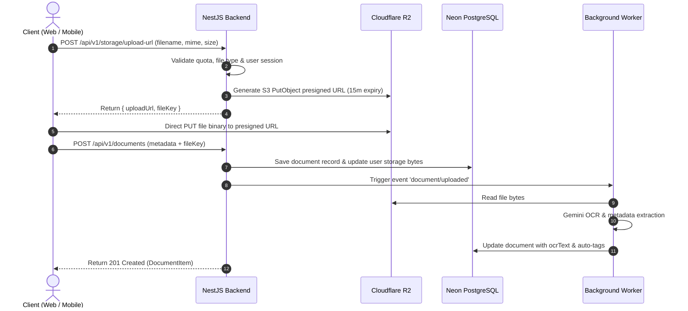

# PaperTrail — Multi-Platform System Architecture

This document describes the high-level system architecture, cross-platform synchronization model, and service boundaries of **PaperTrail – Personal Digital Document Vault**.

---

## 1. Architectural Overview

PaperTrail is organized as a unified monorepo containing three independently deployable applications and six shared packages:

```
┌─────────────────────────────────┐       ┌─────────────────────────────────┐
│         PaperTrail Web          │       │       PaperTrail Mobile         │
│     (React 19 + TypeScript)     │       │   (Expo + React Native Native)  │
│    Vite SPA, Tailwind CSS       │       │    Android APK/AAB & iOS App    │
└────────────────┬────────────────┘       └────────────────┬────────────────┘
                 │                                         │
                 │   HTTP / REST (JWT Bearer Auth)         │
                 └───────────────────┬─────────────────────┘
                                     │
                                     ▼
                     ┌───────────────────────────────┐
                     │      PaperTrail Backend       │
                     │  (NestJS 11 REST API /api/v1) │
                     │  Swagger OpenAPI, Rate Limit  │
                     └───────┬───────────────┬───────┘
                             │               │
            ┌────────────────┴──────┐        └────────────────┐
            ▼                       ▼                         ▼
┌───────────────────────┐ ┌───────────────────┐ ┌───────────────────────────┐
│    Neon PostgreSQL    │ │   Cloudflare R2   │ │     Inngest Worker        │
│      Prisma ORM       │ │  Private Storage  │ │   Background Jobs & Cron  │
│  Users, Docs, Alerts  │ │  Presigned URLs   │ │   Gemini OCR & Resend     │
└───────────────────────┘ └───────────────────┘ └───────────────────────────┘
```

---

## 2. Core Service Boundaries

### A. PaperTrail Web (`apps/web`)
- **Technology**: React 19, TypeScript, Vite 6, Tailwind CSS 3.4, Framer Motion 12, Lucide React.
- **Responsibility**: Desktop, tablet, and responsive browser experience.
- **Key Characteristics**: Preserves PaperTrail's signature cobalt blue (`#0861E8`) 3D layered document card stack, responsive viewport switcher (iPhone frame mode vs. expanded workspace mode), real-time document search, and interactive drag-to-verify slider.
- **Data Integration**: Consumes `@papertrail/api-client` with local offline state fallback.

### B. PaperTrail Mobile (`apps/mobile`)
- **Technology**: Expo SDK 52, React Native 0.76, Expo Router, TypeScript, Reanimated.
- **Target Outputs**:
  - **Android APK**: Standalone installation package for physical device testing.
  - **Android AAB**: Android App Bundle for Google Play Store publication.
  - **iOS App**: Production `.ipa` and Simulator build for TestFlight / App Store.
- **Hardware Integrations**:
  - Camera scanning with `expo-camera` (viewfinder, laser beam animation, edge crop guides).
  - Native file picker with `expo-document-picker`.
  - Biometric authentication via `expo-local-authentication` (Face ID / Touch ID / Android BiometricPrompt).
  - Secure offline token storage via `expo-secure-store`.
  - Push notifications via `expo-notifications`.
  - Native OS sharing via `expo-sharing`.

### C. Centralized Backend (`apps/api`)
- **Technology**: NestJS 11, TypeScript, Swagger/OpenAPI, Prisma ORM, `@clerk/backend`, `@aws-sdk/client-s3`.
- **Responsibility**: Single source of truth for business logic, document metadata, authorization, storage presigning, and expiration mathematics.
- **Security**: Strict document ownership guards, rate limiting, and input validation via `@papertrail/validators`.

### D. Background Worker (`apps/worker`)
- **Technology**: Inngest job processor, Google Gemini API (`@google/genai`), Resend email delivery.
- **Functions**:
  1. `document/uploaded`: Triggered upon file upload to run OCR text extraction and suggest categories.
  2. `scan-expiring-documents`: Daily cron scanning for documents expiring in 15, 30, and 45 days, dispatching email and push notifications.

---

## 3. Storage Architecture: Cloudflare R2 Direct Uploads

To ensure maximum performance and security, files **never pass directly through the backend server**. Instead, PaperTrail uses presigned URLs:



---

## 4. Cross-Platform Synchronization

Both Web and Mobile clients interact with the identical REST API under `/api/v1`:
- **Server Authoritative**: All mutations (create, rename, delete, renew) take effect on Neon PostgreSQL immediately.
- **Offline Cache Invalidation**: Mobile caches documents using `expo-secure-store`. When the device reconnects, the cache is refreshed against the server's `updatedAt` timestamps.
- **Simultaneous Access**: Actions performed on an Android phone (e.g. scanning an insurance card) are instantly visible on the Web application upon refreshing or query invalidation.

---

## 5. Security & Isolation Model

1. **Zero Storage Credential Leakage**: R2 Access Keys and Secret Keys exist solely in the backend runtime environment. Frontend applications receive short-lived, pre-signed URLs scoped to their specific file keys.
2. **Document Ownership Enforced at Database Level**: Every SQL query is parameterized with the authenticated user's `userId` derived from the verified Clerk JWT.
3. **MIME Type & Quota Validation**: File size limits (50 MB default) and total vault storage limits (500 MB default) are validated both in the Zod contract schema and in the storage service before issuing upload tickets.
