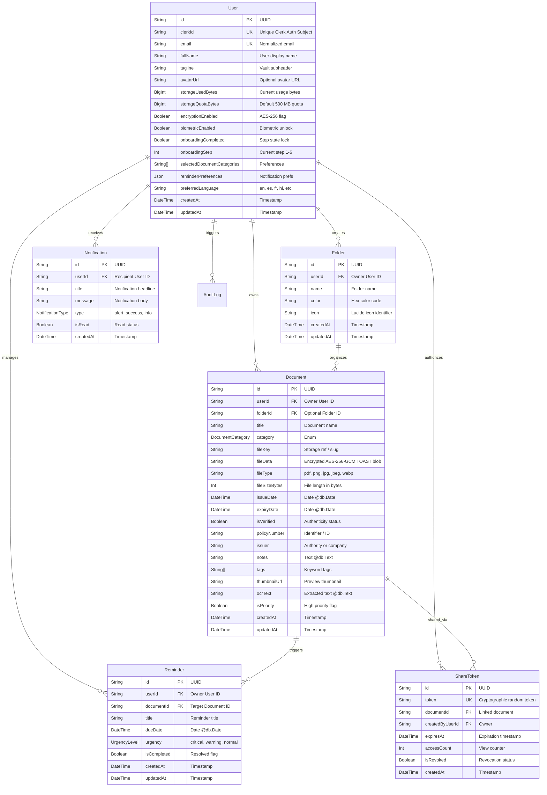

# PaperTrail — Neon PostgreSQL Database Specification

**Database Engine:** Neon Serverless PostgreSQL (PostgreSQL 16)  
**ORM:** Prisma 6.19.3 (`@prisma/client`)  
**Deployment Region:** AWS `us-east-2` (Ohio)  
**Connection Mode:** Pooled Endpoint via PgBouncer (`-pooler`)  

---

## 1. Entity-Relationship Diagram (ERD)



---

## 2. Table Definitions & Column Specifications

### Table: `User`
Maintains user identity synchronized from Clerk session webhooks.

| Column | Type | Constraints | Description |
| :--- | :--- | :--- | :--- |
| `id` | `String` | `@id @default(uuid())` | Primary key UUID |
| `clerkId` | `String` | `@unique` | Immutable Clerk Identity Provider user ID |
| `email` | `String` | `@unique` | Primary contact email address |
| `fullName` | `String` | NOT NULL | Display name |
| `tagline` | `String?` | Default: `"Personal Document Vault"` | Vault header description |
| `avatarUrl` | `String?` | Nullable | Profile image URL |
| `storageUsedBytes` | `BigInt` | Default: `0` | Sum of all stored document bytes |
| `storageQuotaBytes`| `BigInt` | Default: `524288000` (500 MB) | Maximum allocated storage ceiling |
| `encryptionEnabled`| `Boolean` | Default: `true` | Cryptographic vault protection active |
| `biometricEnabled` | `Boolean` | Default: `true` | Biometric unlock authorized |
| `onboardingCompleted`| `Boolean` | Default: `false` | First-time user experience completion lock |
| `onboardingStep` | `Int` | Default: `1` | Progression stage (1 through 6) |
| `selectedDocumentCategories` | `String[]` | Default: `[]` | User's enabled categories |
| `reminderPreferences` | `Json?` | Nullable | Serialized reminder toggle preferences |
| `preferredLanguage`| `String?` | Default: `"en"` | UI locale preference |
| `createdAt` | `DateTime` | `@default(now())` | Account provisioning timestamp |
| `updatedAt` | `DateTime` | `@updatedAt` | Last modification timestamp |

---

### Table: `Document`
Stores document metadata and encrypted payloads directly in PostgreSQL via TOAST.

| Column | Type | Constraints | Description |
| :--- | :--- | :--- | :--- |
| `id` | `String` | `@id @default(uuid())` | Primary key UUID |
| `userId` | `String` | Foreign Key (`User.id`) | Tenant owner ID (Cascades on delete) |
| `folderId` | `String?` | Foreign Key (`Folder.id`) | Optional folder grouping (Sets null on delete) |
| `title` | `String` | NOT NULL | Document title |
| `category` | `DocumentCategory` | Enum | `Insurance`, `Identity`, `Vehicle`, `Education`, `Warranty`, `Finance`, `Medical` |
| `fileKey` | `String?` | Nullable | Document identifier / reference slug |
| `fileData` | `String?` | `@db.Text` | **AES-256-GCM Encrypted Payload** stored in TOAST tables |
| `fileType` | `String` | NOT NULL | Extension: `pdf`, `png`, `jpg`, `jpeg`, `webp` |
| `fileSizeBytes` | `Int` | NOT NULL | Exact byte length of document file |
| `issueDate` | `DateTime?` | `@db.Date` | Official date of issuance |
| `expiryDate` | `DateTime?` | `@db.Date` | Expiration date for renewal automation |
| `isVerified` | `Boolean` | Default: `false` | Official cryptographic seal confirmed |
| `policyNumber` | `String?` | Nullable | Policy, license, or document ID number |
| `issuer` | `String?` | Nullable | Authority or issuing institution |
| `notes` | `String?` | `@db.Text` | Optional user annotations |
| `tags` | `String[]` | Default: `[]` | Search and categorization tags |
| `thumbnailUrl` | `String?` | Nullable | Cached visual thumbnail |
| `ocrText` | `String?` | `@db.Text` | Gemini AI extracted plaintext |
| `isPriority` | `Boolean` | Default: `false` | Pinned priority card flag |
| `createdAt` | `DateTime` | `@default(now())` | Creation timestamp |
| `updatedAt` | `DateTime` | `@updatedAt` | Last updated timestamp |

---

## 3. PostgreSQL TOAST Storage Architecture

When a document is stored in `Document.fileData`:
1. **In-Line Threshold:** Values under 2,048 bytes (2 KB) remain in the main table heap page.
2. **Out-of-Line Compression:** Values exceeding 2 KB are automatically compressed (using LZ4 or pglz compression) and stored across 2 KB chunks in a separate dedicated **TOAST table** (`pg_toast.pg_toast_<table_oid>`).
3. **Pointers in Heap:** The main `Document` row contains only an 18-byte TOAST pointer.
4. **Performance Advantage:** Listing documents (`SELECT id, title, category, expiryDate FROM "Document"`) executes instantaneously without loading multi-megabyte document binaries into memory. The binary payload is streamed only when `fileData` is explicitly requested.

---

## 4. Database Indexing Strategy

Compound indexes optimize sub-millisecond query execution across high-volume collections:

```sql
-- Fast tenant document lookups
CREATE INDEX "Document_userId_idx" ON "Document"("userId");

-- Optimized category tabs filtering
CREATE INDEX "Document_userId_category_idx" ON "Document"("userId", "category");

-- Efficient expiry alerts & sort queries
CREATE INDEX "Document_userId_expiryDate_idx" ON "Document"("userId", "expiryDate");

-- Case-insensitive title searching
CREATE INDEX "Document_userId_title_idx" ON "Document"("userId", "title");

-- Expiry reminder due-date queries
CREATE INDEX "Reminder_userId_dueDate_idx" ON "Reminder"("userId", "dueDate");

-- Unique Clerk ID lookups for authentication gates
CREATE UNIQUE INDEX "User_clerkId_key" ON "User"("clerkId");
```

---

## 5. Cascading Deletion & Privacy Guarantees

In accordance with data protection regulations (India DPDP Act 2023 & GDPR):
* All relations originating from `User` are configured with **`onDelete: Cascade`**.
* Invoking `DELETE FROM "User" WHERE id = :userId` atomically deletes:
  * All `Document` records and their encrypted TOAST payloads.
  * All `Folder` records.
  * All `Reminder` records.
  * All `Notification` records.
  * All `ShareToken` authorizations.
  * All `AuditLog` entries.
* Leaves zero orphaned records, zero shadow files, and zero residual metadata in the database.
