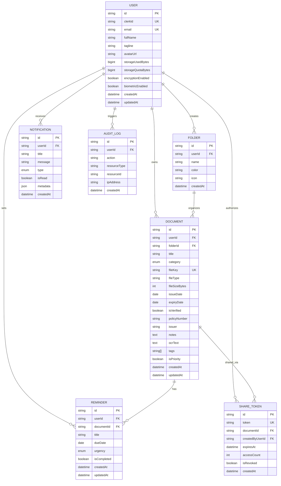

# PaperTrail — Database Schema & Architecture

PaperTrail utilizes **Neon Serverless PostgreSQL** managed via **Prisma ORM**.

---

## Entity Relationship Overview

---

## Detailed Table Specifications

### 1. `User`
Stores root account identity synchronized from Clerk, along with storage limits and security preferences.
- `id`: UUID Primary Key.
- `clerkId`: Clerk user identifier (e.g. `user_2t...`), indexed with a unique constraint.
- `email`: Normalized primary email address.
- `storageUsedBytes`: Current sum of all stored file sizes.
- `storageQuotaBytes`: Hard storage ceiling (default: `524,288,000` = 500 MB).

### 2. `Document`
Core vault record.
- `fileKey`: Unique object path in Cloudflare R2 (`users/{userId}/docs/{timestamp}-{hash}.{ext}`).
- `category`: Enum (`Insurance`, `Identity`, `Vehicle`, `Education`, `Warranty`, `Finance`, `Medical`).
- `expiryDate`: Optional date used by the expiration countdown math.
- `isVerified`: Authenticity verification flag.
- `ocrText`: Asynchronously populated text extracted via the Gemini/Vision OCR worker.

### 3. `Reminder`
Tracks document renewal dates and warranties.
- `urgency`: Enum computed from days remaining (`critical` < 15 days, `warning` < 45 days, `normal`).
- `isCompleted`: Indicates whether the user has addressed or renewed the document.
- Cascades on document deletion (`onDelete: Cascade`).

### 4. `ShareToken`
Manages time-limited public document access.
- `token`: Unique URL slug.
- `expiresAt`: Hard expiration timestamp (default: 48 hours).
- `isRevoked`: Allows instant manual revocation.
- `accessCount`: Monitored view counter.
